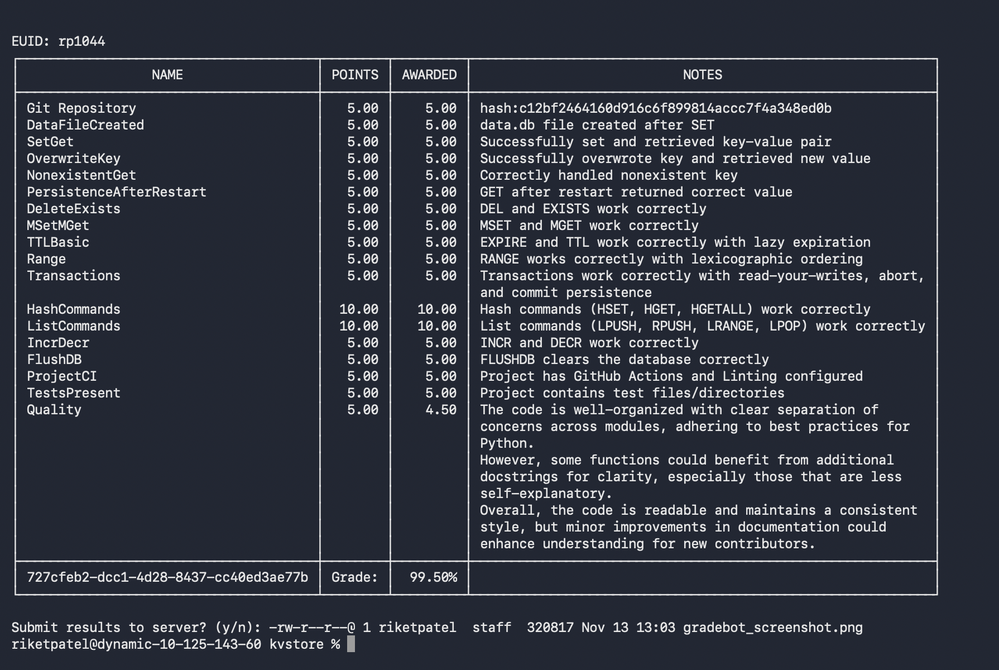

# Simple Key-Value Store

CSCE 3530 Project 1 — Riket Patel (EUID: rp1044)

A persistent, Redis-style key-value store written in Python. Commands are read from STDIN and
replies are written to STDOUT. Every write is appended to `data.db` and fsync'd before the reply,
so data survives restarts and crashes.

## Run

```bash
python3 main.py
```

Requires Python 3.9+ and no third-party packages.

## Commands

| Group | Commands |
|---|---|
| Basic | `SET <key> <value>`, `GET <key>`, `EXIT` |
| Delete / exists | `DEL <key> [key ...]`, `EXISTS <key> [key ...]` |
| Multi | `MSET <k1> <v1> [k2 v2 ...]`, `MGET <k1> [k2 ...]` |
| Expiration | `EXPIRE <key> <seconds>`, `TTL <key>` (`-1` = no TTL, `-2` = missing) |
| Range | `RANGE <start> <end>` (inclusive, sorted; `""` = open bound; ends with `END`) |
| Transactions | `BEGIN`, `COMMIT` (writes the block to disk), `ABORT` |
| Hashes | `HSET <hash> <field> <value>`, `HGET <hash> <field>`, `HGETALL <hash>` |
| Lists | `LPUSH`/`RPUSH <key> <value> [...]`, `LPOP`/`RPOP <key>`, `LRANGE <key> <start> <stop>` |
| Counters | `INCR <key>`, `DECR <key>` |
| Management | `FLUSHDB` |

A missing value prints an empty line. Errors print `ERR <message>`.

## Design

- **`kvstore/index.py`**: hand-written hash table (separate chaining and resizing). The
  assignment forbids built-in dict/map types, so it is used for keys, hash fields and TTLs.
- **`kvstore/storage.py`**: append-only log. Each change is one JSON line, e.g.
  `["SET","name","riket"]`. On startup the log is replayed to rebuild the index. A torn last line
  from a crash is skipped.
- **`kvstore/database.py`**: command logic. The same `_apply` function handles live writes and
  log replay, so state after a restart matches state before it. Last write wins.
  - TTLs are stored as absolute times and checked lazily on access.
  - Transactions copy the index on `BEGIN`, buffer log records, and write them all with one
    fsync on `COMMIT`. `ABORT` restores the copy.
- **`kvstore/cli.py`**: parses each line (quotes supported) and formats replies.

## Tests and CI

```bash
python3 -m unittest discover -s tests -v   # unit + black-box tests
ruff check . && ruff format --check .      # lint
```

GitHub Actions (`.github/workflows/ci.yml`) runs the linter and tests on every push.

## Gradebot

```bash
./gradebot project-1 --dir . --run "python3 main.py"
```

Result (99.50%):



## AI Usage

AI assistance (Claude by Anthropic) was used to help design, write, and test parts of this code. I reviewed, ran, and verified all of it.
